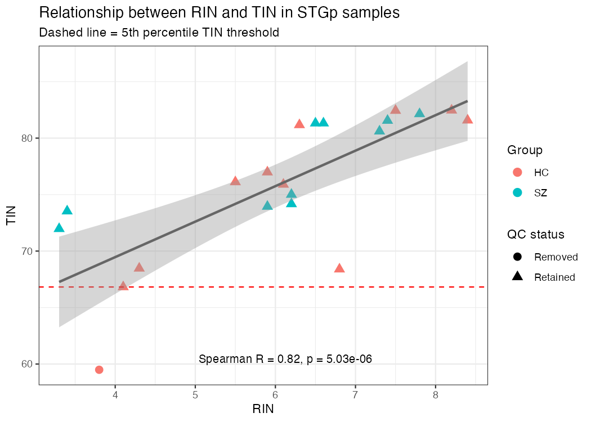
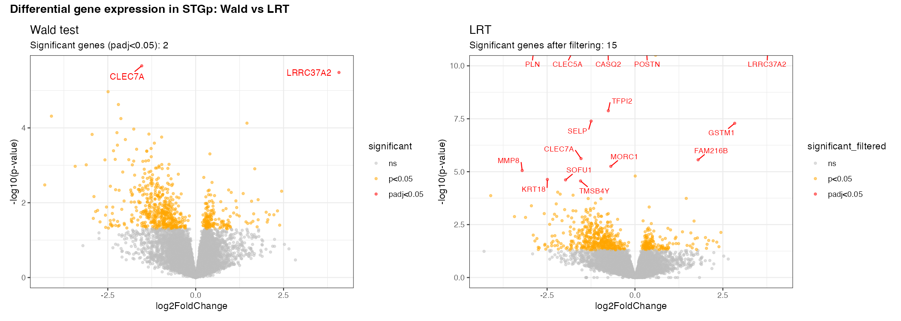
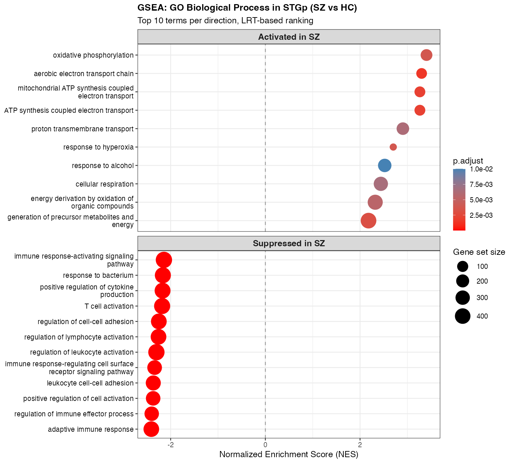

# Differential Transcriptome Analysis of the Posterior Superior Temporal Gyrus in Schizophrenia

Coursework project (HSE University, Faculty of Biology and Biotechnology, Cognitive Neuroscience programme).

Differential gene expression analysis in the posterior superior temporal gyrus (STGp) of patients with schizophrenia (SZ) compared with healthy controls (HC), based on RNA-seq of post-mortem human brain tissue.

## Key findings

- Final sample after QC: 20 samples (10 HC, 10 SZ), with 5 females and 5 males in each group.
- Wald test (padj < 0.05): 2 genes, *CLEC7A* (downregulated in SZ) and *LRRC37A2* (upregulated in SZ).
- Likelihood ratio test (LRT, padj < 0.05): 20 genes, 15 after removing technical artefacts (|log2FC| > 0.5, baseMean < 100,000). Both Wald genes are included in this list.
- GSEA (GO Biological Process, genes ranked by LRT results): 240 significant terms (padj < 0.05), 219 suppressed and 21 activated in SZ. Immune processes are suppressed (e.g. adaptive immune response, leukocyte activation), while mitochondrial energy metabolism is activated (e.g. oxidative phosphorylation, aerobic electron transport chain).

## Analysis design

| Step | Method |
|---|---|
| Quality control | Filtering by TIN (below the 5th percentile); RIN vs TIN relationship (Spearman correlation) |
| Gene selection | Protein-coding genes (`org.Hs.eg.db`); detected in at least 50% of samples in at least one group; total count of at least 10 |
| Modelling | DESeq2, design `~ sex + age + tin + group` |
| Data structure | PCA on VST, rlog and log2(normalized counts + 1) |
| Differential expression | Wald test and likelihood ratio test (LRT), Benjamini-Hochberg correction |
| Functional analysis | GSEA (`clusterProfiler::gseGO`), Gene Ontology Biological Process |

## Selected figures

**Sample quality control: RIN vs TIN and the TIN filter**



**Differential expression: Wald test vs likelihood ratio test**



**GSEA of GO Biological Process terms (top 10 per direction)**



All other figures and tables are written to `results/` when the script is run.

## Repository structure

```
.
├── analysis.R     # full analysis script
├── README.md
├── .gitignore
├── data/          # input data (not included, see below)
└── results/       # figures and tables produced by the script
```

## Input data format

The input data (count matrices and sample metadata) are **not included** in this repository because they belong to a laboratory research project. This section describes the files the script expects in `data/`:

| File | Content |
|---|---|
| `Metadata_rin_tin_age_sex.csv` | Sample metadata: `group`, `region_acr`, `rin`, `tin`, `age`, `sex` |
| `HC_counts_an.txt` | Gene count matrix for healthy controls; first column is `gene_id` |
| `SZ_counts_an.txt` | Gene count matrix for schizophrenia patients; first column is `gene_id` |

The full dataset covers RNA-seq of 42 brain regions from 31 donors (11 HC, 10 SZ, 10 MD, where MD is major depressive disorder). Only the STGp region and the HC and SZ groups are used here.

## Requirements and usage

R 4.2 or newer is required (the analysis was run with R 4.6.2, Bioconductor 3.23; exact package versions are saved to `results/sessionInfo.txt`). Required packages:

```r
install.packages(c("tidyverse", "data.table", "ggrepel", "patchwork", "pheatmap"))

if (!requireNamespace("BiocManager", quietly = TRUE)) install.packages("BiocManager")
BiocManager::install(c("DESeq2", "org.Hs.eg.db", "clusterProfiler"))
```

Place the input files in `data/`, then run:

```r
source("analysis.R")
```

The script writes figures and tables to `results/` and records package versions in `results/sessionInfo.txt`.

## Limitations

- The small sample size (n = 10 per group) limits statistical power.
- Post-mortem interval and antipsychotic treatment are not included in the model.
- The results have not been validated in an independent cohort.

## Author

Anastasia Muravyeva
